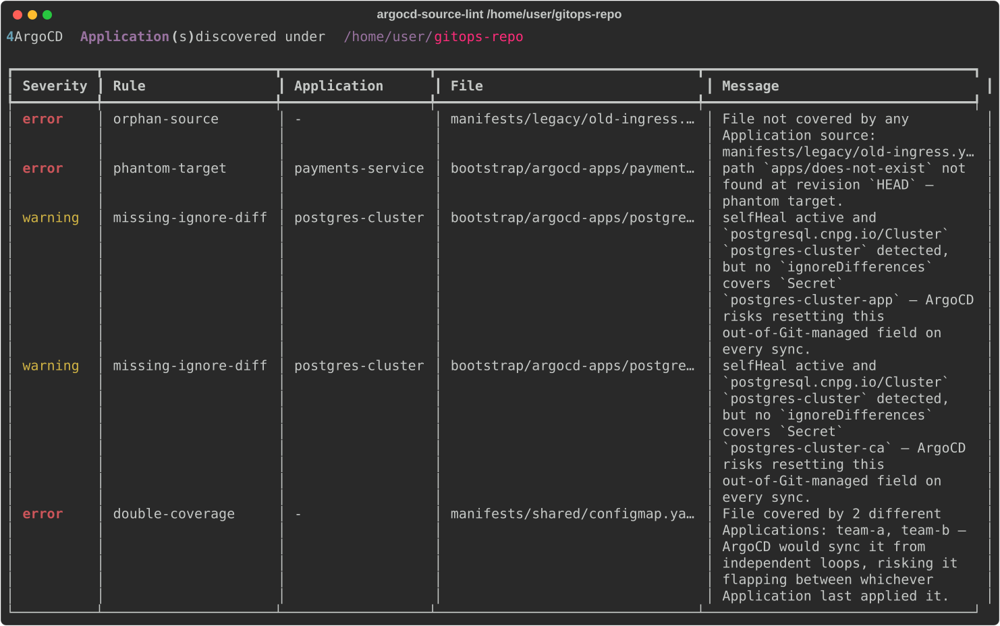

# argocd-source-lint

[](https://github.com/gillesl-dev/argocd-source-lint/actions/workflows/test.yml)
[](./LICENSE)
[](https://www.python.org/)
[](https://github.com/astral-sh/ruff)

Lints ArgoCD Applications for mistakes ArgoCD doesn't report, from the Git checkout alone: no
cluster, kubeconfig or network access.



Some of these mistakes ArgoCD never reports, such as a manifest in an Application's folder
that is never applied, or a misspelled sync option or hook value that it ignores. Others,
such as a `$values` file that doesn't exist, only show up once the change is merged and
synced. This tool reports both on the pull request.

## Quick start

It needs Python 3.11 or later and `git` on `PATH`. From the root of the Git repository that
holds your Applications:

```bash
pipx install argocd-source-lint   # or: pip install argocd-source-lint
argocd-source-lint .
```

`orphan-source`, the check for files no Application deploys, only looks at the folders you
list. Add them in a `.argocd-lint.yaml` at the root of the repository:

```yaml
scan_roots:
  - manifests/
```

A source counts as this repository when its `repoURL` matches the checkout's `origin`
remote. If your Applications use another URL, such as an SSH host alias, list it under
`repo_urls` (see [Configuration](#configuration)); otherwise every source is treated as
another repository, and the output says so.

The exit code is `1` when a blocking problem is found (see [Exit codes](#exit-codes)).
[`examples/full-coverage`](./examples/full-coverage) has one broken Application per rule;
run it from an HTTPS clone of this repository, since its Applications point at that URL.

## Rules

| Rule | Default severity | Detects |
| --- | --- | --- |
| `orphan-source` | error | A YAML file under `scan_roots` that no Application source covers |
| `broken-values-ref` | error | A Helm `valueFiles` entry, including `$ref`, that points to a file that doesn't exist |
| `missing-ignore-diff` | warning | A known operator resource (CNPG, cert-manager, Strimzi...) under `selfHeal: true` without the `ignoreDifferences` its generated objects need |
| `phantom-target` | error | A source `path` that doesn't exist at its `targetRevision` |
| `unresolvable-generator` | info | An `ApplicationSet` generator that can't be resolved from the local checkout alone |
| `double-coverage` | error | The same resource deployed by two Applications to the same cluster and namespace |
| `revision-mismatch` | info | A source whose `targetRevision` points to another commit than the checked-out one |
| `project-scope-violation` | error | An Application source or destination outside the `sourceRepos` or `destinations` allowed by its `AppProject` |
| `hpa-selfheal-conflict` | warning | An HPA and ArgoCD `selfHeal` both managing `spec.replicas` without the required ignore configuration |
| `sync-validation-disabled` | info | The `Validate=false` sync option, which allows an invalid manifest to be applied |
| `duplicate-application-name` | error | Two or more Applications using the same namespace and name |
| `malformed-ignore-diff-pointer` | warning | An `ignoreDifferences.jsonPointers` entry that doesn't start with `/` as required by RFC 6901 |
| `malformed-ignore-diff-jq-expression` | warning | An `ignoreDifferences.jqPathExpressions` entry written as a JSON pointer or a path without its leading `.` |
| `unknown-sync-option` | warning | An unknown or incorrectly cased ArgoCD sync option |
| `unknown-resource-hook` | warning | An unknown ArgoCD hook or hook deletion policy value |
| `malformed-sync-wave` | warning | A sync-wave annotation whose value isn't a valid integer |
| `floating-target-revision` | warning | A `targetRevision` written as a version range instead of an exact pin |

[docs/rules.md](./docs/rules.md) explains each rule, what ArgoCD does in that case, and how to
fix it.

A revision that isn't in the checkout at all can't be checked. `phantom-target` and
`broken-values-ref` report it as `unverifiable` instead of guessing.

## Limitations

- Helm charts and Kustomize overlays are not rendered. A resource a chart template produces
  never exists as a file, so no rule sees it. `orphan-source` does follow the local files a
  `kustomization.yaml` references; remote ones are skipped.
- A source in another Git repository can't be inspected. It is reported as `info`.
- The `list`, `git`, `matrix` and `merge` ApplicationSet generators are resolved locally,
  and the Applications they produce go through every rule. `clusters`, `scmProvider`,
  `pullRequest` and `plugin` generators, `goTemplate: true`, `templatePatch` and `selector`
  give `unresolvable-generator` instead, and the files those Applications may deploy are
  reported by `orphan-source` as `info`.
- The repository is read as one GitOps tree. A template repository with one tree per
  cluster gets `duplicate-application-name` for names repeated across trees, unless the
  trees are listed in `argocd_instances`.
- Nothing that depends on the live cluster is checked.
- Known false positives, to be fixed: `sourceHydrator` sources, Kustomize options set in the
  Application itself (`components`, `patches`, `namePrefix`, `nameSuffix`, `namespace`), an
  AppProject that lists destinations both by `server` and by `name`, `group: '*'` in
  `ignoreDifferences`, and `spec.sources: []`. The
  `unknown-resource-hook` message also says such a resource is applied as a plain one, when
  ArgoCD never applies it.

## Using it on an existing repository

The first run on an established repository may report findings you don't want to fix right
away, such as a manifest left over from a removed component. Record them as a baseline:

```bash
argocd-source-lint . --write-baseline
```

This writes `.argocd-lint-baseline.yaml`. Commit it: later runs report only new findings. The
file is plain YAML, and running `--write-baseline` again replaces it with the current findings.

To accept a finding for one Application instead, annotate it with the rule and a reason:

```yaml
metadata:
  annotations:
    argocd-source-lint/ignore-phantom-target: "path is created by a Job at sync time"
```

## Usage

```bash
argocd-source-lint [PATH] [OPTIONS]
```

| Option | Effect |
| --- | --- |
| `--format`, `-f` | `table` (default), `json`, `sarif`, `gitlab-codequality`, `junit`, or `github` for pull request annotations in GitHub Actions |
| `--output`, `-o` | Write the report to a file instead of stdout |
| `--show-info` | List `info` findings in the table instead of counting them per rule |
| `--fail-on-empty` | Exit with `1` when no ArgoCD Application is found |
| `--write-baseline` | Accept every current finding into `.argocd-lint-baseline.yaml` |
| `--only RULE`, `--skip RULE` | Run only these rules, or all but these. Repeatable |
| `--target-branch BRANCH` | Branch a pull request goes into; Applications tracking it are checked against the checkout |
| `--list-rules` | Print every rule with its default severity |
| `--version` | Print the version |

`info` findings never block CI, so the table only counts them, one line per rule. A source in
another repository is counted once, although several rules each report it. JSON, SARIF, JUnit
and GitLab reports always include every finding.

When no ArgoCD Application is found, or `scan_roots` is not set, the output says what was not
checked instead of "No issues detected" (on stderr for the formats other than `table`).

### Exit codes

| Code | Meaning |
| --- | --- |
| `0` | No blocking finding |
| `1` | At least one blocking finding, or no Application found with `--fail-on-empty` |
| `2` | The tool could not run: path not found, `git` missing, an invalid `.argocd-lint.yaml`, an unknown rule in `--only`/`--skip`, or `--write-baseline` combined with either |

An `error` always blocks. An `unverifiable` finding blocks too by default, so an incomplete
checkout doesn't look like a clean run; `unverifiable_blocks_ci: false` in
`.argocd-lint.yaml` makes it non-blocking.

## CI/CD integration

The linter needs the commits your Applications target. A revision is looked up as written,
then as `origin/<revision>`, so a branch that only exists as a remote-tracking branch, as in
the detached checkout of a pull request, is found. A revision missing from the clone comes out
as `unverifiable`.

In a pull request, Applications that track the branch the change goes into are checked
against the change itself. The branch is read from `GITHUB_BASE_REF` (GitHub) or
`CI_MERGE_REQUEST_TARGET_BRANCH_NAME` (GitLab merge request pipelines); elsewhere, pass
`--target-branch main`.

Each tag of the GitHub Action and the GitLab component installs its own release of the tool,
so `@v1.4.1` always runs 1.4.1. On GitHub, `@v1` follows the latest 1.x release.

### GitHub Actions

```yaml
jobs:
  lint:
    runs-on: ubuntu-latest

    permissions:
      security-events: write
      actions: read
      contents: read

    steps:
      - uses: actions/checkout@v4
        with:
          fetch-depth: 0

      - uses: gillesl-dev/argocd-source-lint@v1.4.1
```

`fetch-depth: 0` fetches every branch and tag, so Applications pinned to another branch or a
tag can be checked; `actions/checkout` fetches a single commit by default. The SARIF report is
uploaded to code scanning, which needs `security-events: write` (`actions: read` and
`contents: read` only on private repositories). On pull requests from forks and from
Dependabot, whose token is read-only, a failed upload doesn't fail the job.

| Input | Default | Effect |
| --- | --- | --- |
| `path` | `.` | Root of the Git repository, not a subfolder of it |
| `fail-on-error` | `true` | `false` reports without failing the job, for a progressive rollout. A tool error (exit code `2`) still fails it |
| `fail-on-empty` | `true` | Fail when no Application is found, which usually means a wrong path |
| `upload-sarif` | `true` | `false` where code scanning isn't available, such as a private repository without GitHub Code Security |
| `category` | | Code scanning category of the report. Needed when the Action runs more than once in a workflow run, such as once per path |
| `args` | | Extra options, for example `--skip orphan-source`. Split on spaces, so an option value can't contain one. `--format` and `--output` are set by the Action |
| `python-version` | `3.11` | Python used to run the tool, in its own virtual environment |

The `sarif-file` output gives the path of the SARIF report. With `fail-on-error: false`, a
missing Application doesn't fail the job either; only a tool error does.

### GitLab CI

A GitLab component has to be hosted on the same GitLab instance as the projects using it.
Copy [`templates/lint.yml`](./templates/lint.yml) into a project on your instance, with a
`README.md` at its root, then include it by tag, branch or commit SHA. It doesn't need to be
published in the CI/CD Catalog.

```yaml
include:
  - component: $CI_SERVER_FQDN/<your-gitlab-group>/argocd-source-lint/lint@v1.4.1
```

GitLab runs merge request pipelines only when the project's own `.gitlab-ci.yml` asks for
them; rules inside an included component don't count. Without them the job runs in branch
pipelines, where `CI_MERGE_REQUEST_TARGET_BRANCH_NAME` isn't set, so Applications tracking
the target branch are checked against that branch instead of the change. Add, for example:

```yaml
workflow:
  rules:
    - if: $CI_PIPELINE_SOURCE == "merge_request_event"
    - if: $CI_COMMIT_BRANCH == $CI_DEFAULT_BRANCH
```

or pass `--target-branch` through the `args` input.

The job publishes a Code Quality report and prints the table.

| Input | Default | Effect |
| --- | --- | --- |
| `scope` | `.` | Root of the Git repository, not a subfolder of it |
| `fail_on_error` | `true` | As `fail-on-error` above |
| `fail_on_empty` | `true` | As `fail-on-empty` above |
| `args` | | Extra options, split on spaces. Quote a `*` so the shell doesn't expand it |
| `stage` | `test` | Stage of the job |
| `job_name` | `argocd-source-lint` | Name of the job, distinct for each include of the component |
| `image` | `python:3.11-slim` | Image the job runs in. It needs Python 3.11 or later, and `git` or `apt-get`. Without Internet access, use a mirrored image and set `PIP_INDEX_URL` to your PyPI mirror |

A GitLab job clones the ref being tested, shallow by default (`GIT_DEPTH` is 20 on new
projects). Applications tracking the merge request's target branch need nothing more. One
pinned to another branch or a tag comes out as `unverifiable` until that ref is in the clone.

### pre-commit

The hook needs Python 3.11 or later as pre-commit's default Python.

```yaml
repos:
  - repo: https://github.com/gillesl-dev/argocd-source-lint
    rev: v1.4.1
    hooks:
      - id: argocd-source-lint
```

## Configuration

`.argocd-lint.yaml` at the root of the repository. Every key is optional;
[`.argocd-lint.example.yaml`](./.argocd-lint.example.yaml) shows them all.

| Key | Default | Effect |
| --- | --- | --- |
| `scan_roots` | none | Folders where every YAML file should belong to an Application. Without it, `orphan-source` checks nothing, and the output says so |
| `exclude_paths` | none | Glob patterns of repository paths `orphan-source` ignores, such as `manifests/legacy/**` |
| `rules` | the severities above | Severity per rule ID: `error`, `warning` or `info`. An unknown rule ID exits with code `2` |
| `unverifiable_blocks_ci` | `true` | Whether an `unverifiable` finding gives exit code `1` |
| `repo_urls` | none | Other URLs ArgoCD uses for this repository than the checkout's `origin` remote, such as an SSH host alias or a mirror |
| `new_git_file_globbing` | `false` | `true` when the ApplicationSet controller runs with `--enable-new-git-file-globbing`, which changes how git `files` generator patterns match |
| `argocd_instances` | none | Folders that each hold the Applications of a separate ArgoCD instance. Names and destinations are compared only within one instance |
| `argocd_version` | none | Your ArgoCD version, such as `"3.2.0"`. `unknown-sync-option` and `unknown-resource-hook` then also report values that version doesn't know yet, such as the Application-level `Prune` sync option before 3.4.0 |
| `known_operators` | none | More operator signatures for `missing-ignore-diff`, added to the built-in ones (see [docs/rules.md](./docs/rules.md#missing-ignore-diff)) |

## Compared to other tools

None of the tools below documents a rule for orphan sources, missing `ignoreDifferences`,
phantom targets, or double coverage (checked against their documentation in November 2026).
`argocd-lint` has rules close to `floating-target-revision`, `project-scope-violation` and
`duplicate-application-name`; the last one compares names only, not namespace and name.

| | Needs a cluster or a running ArgoCD | Primary purpose |
| --- | --- | --- |
| `argocd-source-lint` | No | Static analysis of the Git checkout (see [Rules](#rules)) |
| [argocd-diff-preview](https://github.com/dag-andersen/argocd-diff-preview) | Starts a throwaway cluster with ArgoCD (needs Docker), or uses an existing ArgoCD | Shows the rendered manifest diff on a pull request |
| [kubechecks](https://github.com/zapier/kubechecks) | Yes | Schema/policy checks (`kubepug`, `kubeconform`, `conftest`) plus a live-state diff comment on a pull request |
| [argocd-lint](https://github.com/harchuk/argocd-lint) | No, except its optional server dry run | Best-practice rules for `Application`, `ApplicationSet` and `AppProject`, extensible with Rego |
| [drydock](https://github.com/sholdee/drydock) | No | Renders, tests and diffs ArgoCD Applications offline, with diagnostics for rendering, health checks and AppProjects |
| [glint](https://github.com/lukashankeln/glint) | No | Renders Helm and Kustomize, then applies your own CEL policies to ArgoCD Applications, Flux HelmReleases and plain resources |
| [conftest](https://www.conftest.dev/) / [kubeconform](https://github.com/yannh/kubeconform) | No | Generic OPA policy checks and schema validation, not aware of ArgoCD's semantics. The [CRDs catalog](https://github.com/datreeio/CRDs-catalog) has schemas for ArgoCD's resources |

## Development

```bash
uv sync --extra dev
uv run argocd-source-lint .
uv run pytest
```

For implementation details, see [DESIGN.md](./DESIGN.md). To add a rule or an operator
signature, see [CONTRIBUTING.md](./CONTRIBUTING.md).

This project is developed with AI coding assistants (Claude Code). The rules are written from
ArgoCD's source code, which is cited where each behavior is implemented, and the test suite
(500+ tests) runs on Linux and Windows. Known limitations and false positives are listed under
[Limitations](#limitations).

## License

MIT. See [LICENSE](./LICENSE).
